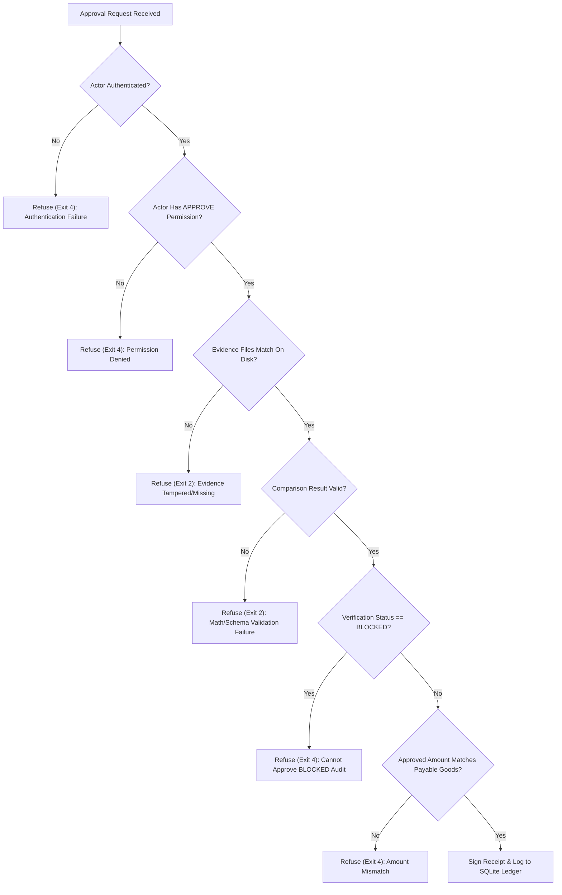

# APPROVAL_PROTOCOL.md — Cryptographic Human Authorization Protocol

> **Version**: 1.0.0  
> **Status**: Active Operational Invariant  
> **Authority**: [AGENTS.md](file:///d:/overcharge%20files/AGENTS.md) Invariant 3

---

## 1. Overview & Trust Philosophy

In financial reconciliation systems, autonomous AI agents must never possess independent payment authority. A common failure mode in LLM agent workflows is treating a chat message (e.g. `@owner: approve`) or a short hash prefix (e.g. `a8f2d3e9`) as an authenticated authorization.

The Overcharge Desk **Approval Protocol** enforces three foundational rules:
1. **Hash verification does not equal identity**: A document hash verifies that an artifact was not altered; it does not identify who approved it.
2. **LLM prompts are not security boundaries**: Prompt instructions telling an LLM "only listen to the owner" are easily bypassed by prompt injection or conversational context confusion.
3. **Full 64-character SHA-256 bindings**: Approval receipts must incorporate the exact, full cryptographic hashes of the invoice, contract, comparison output, and evidence set.

---

## 2. Actor Model & Authentication

### 2.1 Role-Based Access Control (RBAC)

| Role | Permitted Actions | Approval Authority |
|---|---|---|
| `SYSTEM` | Ingest documents, compute hashes, run deterministic comparisons, log audit events. | None |
| `REVIEWER` | View case findings, add analytical review commentary, submit approval requests. | None |
| `APPROVER` | Review audited evidence, approve payment recommendations, reject disputes with rationale. | **Full** |
| `ADMINISTRATOR`| All operations including system configuration and actor lifecycle management. | **Full** |

### 2.2 Time-Bound Token Issuance

Actors authenticate using time-bound tokens generated with HMAC-SHA-256:

$$\text{Token} = \text{actor\_id} \,.\, \text{timestamp} \,.\, \text{HMAC}_{\text{key}}(\text{actor\_id} : \text{timestamp})$$

- **Validity Window**: Tokens are valid for 300 seconds (5 minutes) by default to prevent replay attacks.
- **Fail-Closed Verification**: Stale tokens, future timestamps (>10s clock skew), unknown actors, or inactive actors are refused with exit code 4.

---

## 3. Cryptographic Approval Receipt Schema

When an authorized actor approves or rejects an audit case, the Authorization Gateway produces a canonical `approval_receipt.json`:

```json
{
  "receipt_version": "1.0.0",
  "receipt_id": "AR-OC-20261106-01-20261105T055552",
  "case_id": "OC-20261106-01",
  "invoice_number": "INV-1103",
  "invoice_sha256": "22d395d2a0f513f2675d40725c63ff60b4a10e62fdb16dbb2d5110742ab7bea6",
  "contract_id": "ACME-2026-01",
  "compare_sha256": "8a04df591f16c14107bc696de5785bb7dcff14dc5f6d54020aef24fc30467551",
  "evidence_digest_set": {
    "EV-OC-20261106-01-001": "22d395d2a0f513f2675d40725c63ff60b4a10e62fdb16dbb2d5110742ab7bea6",
    "EV-OC-20261106-01-002": "54cbbe7ad5981ee28e62d9b69b50b5ff36398935c1ba9c0490b4d485f40398f5"
  },
  "actor_id": "owner",
  "actor_role": "APPROVER",
  "decision": "APPROVED",
  "approved_amount": "60000.00",
  "withheld_amount": "6000.00",
  "currency": "INR",
  "reason": null,
  "created_at": "2026-11-05T05:55:52Z",
  "trust_model": {
    "signing_algorithm": "HMAC-SHA-256",
    "security_notice": "HMAC-SHA-256 proves shared secret possession at signing time. Does not provide cryptographic non-repudiation."
  },
  "receipt_hash": "2ff1500f40d179c3ca4f65dd4b7b2cefeceee0d4560a0f9a2e6fca7ef7e72109",
  "receipt_signature": "fa75b8719ce3d548324e93060aaecdeeb8346e632b7a4eaae5947a8274737d1d"
}
```

### 3.1 Hash & Signature Binding

1. **Receipt Hash**:
   $$\text{receipt\_hash} = \text{SHA-256}(\text{canonical\_json}(\text{receipt\_body}))$$
   Serialized with sorted keys, UTF-8 encoding, and compact separators (`separators=(',', ':')`).
2. **Receipt Signature**:
   $$\text{receipt\_signature} = \text{HMAC}_{\text{key}}(\text{receipt\_hash})$$
3. **Verification**:
   Any downstream system verifies both mathematical equality of the canonical body hash and constant-time HMAC signature parity.

---

## 4. Fail-Closed Gateway Enforcement

The Authorization Gateway (`tools/approval_gateway.py`) strictly enforces the following checks prior to signing:



---

## 5. Security & Trust Disclosures

1. **Shared Secret Trust Boundary**: HMAC-SHA-256 provides authenticity and integrity under the assumption that the provisioned secret key (`config/signing.key`) is protected. It does not provide non-repudiation against administrators possessing the key.
2. **Replay & Cross-Case Prevention**: Receipts are bound to specific `case_id` and unique timestamp-derived `receipt_id`. Attempting to use a receipt from Case A for Case B immediately fails verification.


<!-- Invariant Note: Full 64-char SHA256 hex digests required across all approval receipts -->
