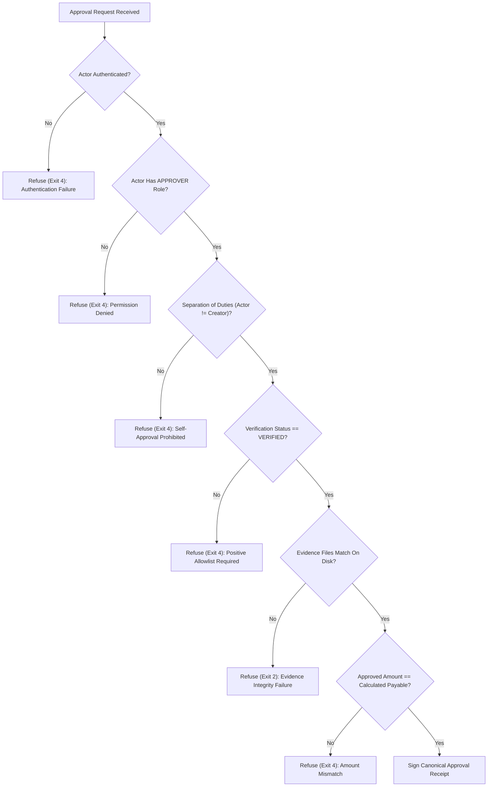

# APPROVAL_PROTOCOL.md — Cryptographic Human Authorization Protocol

> **Version**: 3.0.0  
> **Status**: Active Operational Invariant  
> **Authority**: [AGENTS.md](file:///d:/overcharge%20files/AGENTS.md) Invariant 3

---

## 1. Overview & Trust Philosophy

In financial reconciliation systems, autonomous AI agents must never possess independent payment authority. A common failure mode in LLM agent workflows is treating a chat message (e.g. `@owner: approve`) or a short hash prefix (e.g. `a8f2d3e9`) as an authenticated authorization.

The Overcharge Desk **Approval Protocol** enforces four foundational rules:
1. **Hash verification does not equal identity**: A document hash verifies that an artifact was not altered; it does not prove who approved it.
2. **LLM prompts are not security boundaries**: Prompt instructions telling an LLM "only listen to the owner" are easily bypassed by prompt injection or conversational context confusion.
3. **Full 64-character SHA-256 bindings**: Approval receipts must incorporate the exact, full cryptographic hashes of the invoice, contract, comparison output, verification record, and evidence set.
4. **Strict Separation of Duties**: The user who created or ingested the case cannot be the user who approves the payment recommendation.

---

## 2. Actor Model & Role-Based Access Control (RBAC)

### 2.1 Enterprise Operational Roles

| Role | Permitted Actions | Approval Authority |
|---|---|---|
| `ADMINISTRATOR` | Manage users, roles, system configuration, key rotation. | Full |
| `FINANCE_OPERATOR` | Ingest invoices, configure cases, run reconciliation pipelines. | None |
| `REVIEWER` | View case findings, inspect discrepancies, request approvals. | None |
| `APPROVER` | Review audited evidence, approve payment recommendations, reject disputes with rationale. | **Full (Positive Allowlist only)** |
| `AUDITOR` | Read-only inspection of cases, receipts, ledger, and checkpoints. | None (Read-only) |
| `PAYMENT_OPERATOR` | Export authorized payment recommendation instructions. | None |

### 2.2 Time-Bound Token Issuance

Actors authenticate using time-bound tokens generated with HMAC-SHA-256:

$$\text{Token} = \text{actor\_id} \,.\, \text{timestamp} \,.\, \text{HMAC}_{\text{key}}(\text{actor\_id} : \text{timestamp})$$

- **Validity Window**: Tokens are valid for 300 seconds (5 minutes) by default to prevent replay attacks.
- **Fail-Closed Verification**: Stale tokens, future timestamps (>10s clock skew), unknown actors, or inactive actors are refused with exit code 4.

---

## 3. Cryptographic Approval Receipt Schema (Version 2.0.0)

When an authorized actor approves or rejects an audit case, the Authorization Gateway produces a canonical `approval_receipt.json`:

```json
{
  "receipt_version": "2.0.0",
  "receipt_id": "AR-OC-20261106-01-20261105T073902",
  "case_id": "OC-20261106-01",
  "verification_id": "VRF-OC-20261106-01-20261105T073901",
  "ledger_head_at_approval": "fe4d18521eeed35c727a88a11a8d4249fb9f40e007088be949c4c302f7b56bca",
  "signing_key_id": "default",
  "invoice_number": "INV-1103",
  "invoice_sha256": "2c7d4c457e0b1d3f59092f997676589139738a89843c30da25824f1fbfe54543",
  "contract_id": "ACME-2026-01",
  "compare_sha256": "026214fb450bf93f5ea78c2e68c983d5a498b584d436573c735d49fe47137f88",
  "evidence_digest_set": {
    "EV-OC-20261106-01-001": "2c7d4c457e0b1d3f59092f997676589139738a89843c30da25824f1fbfe54543",
    "EV-OC-20261106-01-002": "54cbbe7ad5981ee28e62d9b69b50b5ff36398935c1ba9c0490b4d485f40398f5",
    "EV-OC-20261106-01-003": "026214fb450bf93f5ea78c2e68c983d5a498b584d436573c735d49fe47137f88",
    "EV-OC-20261106-01-004": "e3b0c44298fc1c149afbf4c8996fb92427ae41e4649b934ca495991b7852b855"
  },
  "actor_id": "owner",
  "actor_role": "APPROVER",
  "decision": "APPROVED",
  "approved_amount": "60000.00",
  "withheld_amount": "6000.00",
  "currency": "INR",
  "reason": null,
  "created_at": "2026-11-05T07:39:02Z",
  "trust_model": {
    "signing_algorithm": "HMAC-SHA-256",
    "security_notice": "HMAC-SHA-256 proves shared secret possession at signing time. Does not provide asymmetric cryptographic non-repudiation."
  },
  "receipt_hash": "2ff1500f40d179c3ca4f65dd4b7b2cefeceee0d4560a0f9a2e6fca7ef7e72109",
  "receipt_signature": "fa75b8719ce3d548324e93060aaecdeeb8346e632b7a4eaae5947a8274737d1d"
}
```

### 3.1 Hash & Signature Binding

1. **Receipt Hash**:
   $$\text{receipt\_hash} = \text{SHA-256}(\text{canonical\_json}(\text{receipt\_body}))$$
   Serialized with sorted keys, UTF-8 encoding, and compact separators (`separators=(',', ':')`).
2. **Receipt Signature**:
   $$\text{receipt\_signature} = \text{HMAC}_{\text{key}}(\text{receipt\_hash})$$
3. **Verification**:
   The verification routine (`verify_approval_receipt()`) strictly recomputes canonical body bytes, verifies signature parity in constant time, and ensures that `case_id`, `verification_id`, and `compare_sha` match expectations.

---

## 4. Fail-Closed Gateway Enforcement

The Authorization Gateway (`tools/approval_gateway.py`) strictly enforces the following checks:



---

## 5. Out-of-Band Interactive Terminal Authorization (`tools/approve.py`)

To eliminate the vulnerability where agents sharing a shell process or chat room might attempt to approve payments autonomously, Overcharge Desk enforces an out-of-band terminal protocol:

1. **Mandatory Interactive TTY Gate**:
   `tools/approve.py` inspects `sys.stdin.isatty()`. Subshell invocations, pipes (`|`), redirects (`<`), and headless background agents are refused fail-closed with exit code 4.
2. **Argon2id Password Authentication**:
   Prompts the human owner for credentials using `getpass.getpass()`, verifying against the persistent SQLite store (`IdentityRepository`) using memory-hard Argon2id.
3. **Role Validation**:
   Requires explicit `APPROVER` or `ADMINISTRATOR` authority.
4. **Server-Side Calculated Amount**:
   The payable subtotal is derived directly from `compare.json` on disk; manual caller-provided payment figures are strictly checked against deterministic math.
5. **Full 64-Character SHA-256 Receipt**:
   Emits the unshortened cryptographic hash and formats a verified notification message for the owner to paste into the Switch room.
6. **No Agent Approval Command**:
   `tools/desk.py` strictly omits an `approve` subcommand; AI agents cannot trigger or execute financial approvals.
