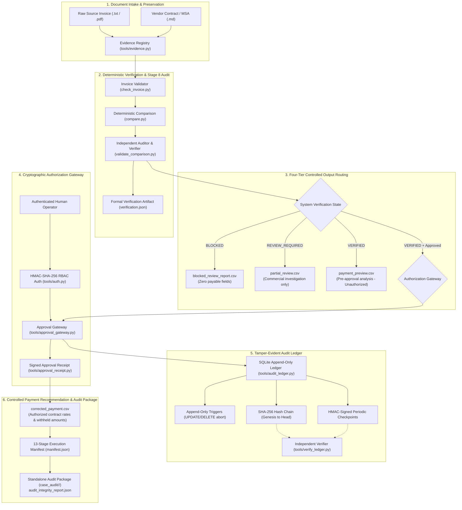

# ARCHITECTURE.md — Overcharge Desk Technical Architecture

> **System**: Overcharge Desk — Evidence-First Vendor Reconciliation & Cryptographic Payment Control  
> **Version**: 3.0.0  
> **Authority**: [AGENTS.md](file:///d:/overcharge%20files/AGENTS.md)

---

## 1. High-Level Architecture Overview

Overcharge Desk is designed as a **fail-closed, evidence-first payment control pipeline**. It strictly separates non-deterministic language extraction from deterministic arithmetic verification, independent comparison auditing, cryptographic human authorization, and tamper-evident append-only ledgering.



---

## 2. The 13-Stage Reconciliation Pipeline (`tools/pipeline.py`)

The pipeline executes a deterministic, fail-closed sequence of 13 stages:

1. **Stage 1 (Load & Parse Metadata)**: Loads invoice JSON and vendor configuration safely.
2. **Stage 2 (Schema Validation)**: Executes strict bounds and type checks on invoice structure via `check_invoice.find_issues()`.
3. **Stage 3 (Vendor & Currency Match)**: Confirms vendor ID parity, currency match, and safe relative paths.
4. **Stage 4 (Raw Evidence Intake)**: Fingerprints source invoice file with 64-character SHA-256 digest in `evidence_registry.json`.
5. **Stage 5 (Source Re-hashing)**: Recalculates cryptographic digest directly from on-disk source file.
6. **Stage 6 (Declaration Parity)**: Verifies that on-disk source digest matches invoice declaration (detects pre-run tampering).
7. **Stage 7 (Deterministic Rate Comparison)**: Computes line-level variances using exact `decimal.Decimal` arithmetic (`tools/compare.py`).
8. **Stage 8 (Independent Verification)**: Generates formal `verification.json` and companion `.sha256` digest certifying rate and math parity (`tools/validate_comparison.py`).
9. **Stage 9 (Fail-Closed Evidence Registration)**: Registers all comparison and verification artifacts into `evidence_registry.json` (halts pipeline if write fails).
10. **Stage 10 (SQLite Audit Ledger Recording)**: Logs `COMPARISON_COMPLETED` and `EVIDENCE_REGISTERED` events into `ledger.db` (halts pipeline if database unavailable).
11. **Stage 11 (Authorization Gate)**: Validates signed approval receipt if `--require-approval` is specified; routes to pre-approval preview if unapproved.
12. **Stage 12 (Artifact Generation)**: Emits exactly one authorized CSV artifact based on verification and approval states (`corrected_payment.csv`, `payment_preview.csv`, `partial_review.csv`, or `blocked_review_report.csv`).
13. **Stage 13 (Execution Manifest)**: Writes structured `manifest.json` recording stage durations, status records, artifact references, and digests for crash recovery.

---

## 3. Four-Dimensional State Model (`tools/state_model.py`)

To prevent ambiguous states, the system evaluates cases across 4 independent dimensions:

| Dimension | Permitted Values | Meaning |
|---|---|---|
| **VerificationStatus** | `NOT_VERIFIED`, `VERIFIED`, `REVIEW_REQUIRED`, `BLOCKED`, `INVALIDATED` | Technical, arithmetic, and evidence integrity status. |
| **CommercialStatus** | `COMPLIANT`, `OVERCHARGED`, `UNDERCHARGED`, `UNSUPPORTED_CHARGES`, `AMBIGUOUS`, `DISCREPANCY`, `UNDETERMINED` | Economic relationship between billed amounts and contract terms. |
| **ApprovalStatus** | `NOT_REQUESTED`, `PENDING`, `APPROVED`, `REJECTED`, `REVOKED` | Human governance and cryptographic authorization status. |
| **PaymentRecommendationStatus** | `PRE_APPROVAL_PREVIEW`, `AUTHORIZED_CORRECTED_PAYMENT`, `PARTIAL_REVIEW_ONLY`, `DISCREPANCY_BLOCKED`, `PAYMENT_PROHIBITED` | Release eligibility of monetary payment recommendation. |

Cross-dimensional consistency is validated by `validate_state_consistency()`, rejecting invalid combinations (such as an unapproved case having `AUTHORIZED_CORRECTED_PAYMENT`).

---

## 4. Production Application Structure (Phase 3)

```text
overcharge-desk/
├── tools/                  # Deterministic core financial engine & CLI tools
│   ├── compare.py          # Exact Decimal rate reconciliation
│   ├── check_invoice.py    # Invoice integrity & schema validator
│   ├── validate_comparison.py # Independent verification & verification.json generator
│   ├── approval_gateway.py # Authorization gateway & allowlist enforcement
│   ├── approval_receipt.py # HMAC receipt generator & validator
│   ├── audit_ledger.py     # SQLite append-only ledger & signed checkpoints
│   ├── verify_ledger.py    # Independent ledger hash chain verifier
│   ├── export_audit_package.py # Standalone audit package exporter & verifier
│   └── pipeline.py         # 13-stage controlled pipeline orchestrator
├── domain/                 # Core business models & policies
│   ├── identity/           # User models, authentication credentials, sessions
│   ├── authorization/      # RBAC policies & separation of duties enforcement
│   ├── cases/              # Case lifecycle state machine
│   └── audit/              # Checkpoint policies & rotation schedules
├── services/               # Application services
│   └── api/                # FastAPI backend service
│       ├── routes/         # REST API endpoints (cases, approvals, audit, vendors)
│       ├── schemas/        # Pydantic request/response schemas
│       ├── middleware/     # Auth, logging, error handling
│       └── main.py         # Application entry point
├── apps/                   # Client applications
│   └── web/                # Finance Operations web dashboard
└── tests/                  # Test suites (139 passing tests)
```

---

## 5. Ledger Hash Chain & Checkpoint Mechanics

Each event in the SQLite audit ledger (`ledger.db`) is cryptographically linked to its predecessor:

$$\text{EventHash}_n = \text{SHA-256}\left(\text{canonical}\left(\begin{aligned}
&\text{event\_id}_n, \, \text{seq}_n, \, \text{case\_id}_n, \, \text{event\_type}_n, \\
&\text{actor\_id}_n, \, \text{timestamp}_n, \, \text{payload}_n, \, \text{refs}_n, \, \text{EventHash}_{n-1}
\end{aligned}\right)\right)$$

- **Genesis**: Event 1 has $\text{EventHash}_0 = 0^{64}$ (64 hexadecimal zeros).
- **Append-Only Enforcement**: SQLite triggers (`trg_prevent_audit_update`, `trg_prevent_audit_delete`) abort direct `UPDATE` and `DELETE` attempts.
- **Signed Checkpoints**: Periodic signed checkpoints capture `highest_sequence`, `head_event_hash`, and a cumulative `chain_digest` signed with HMAC-SHA-256.
- **Independent Verification**: `verify_ledger.py` validates the database independently of runtime claims.
