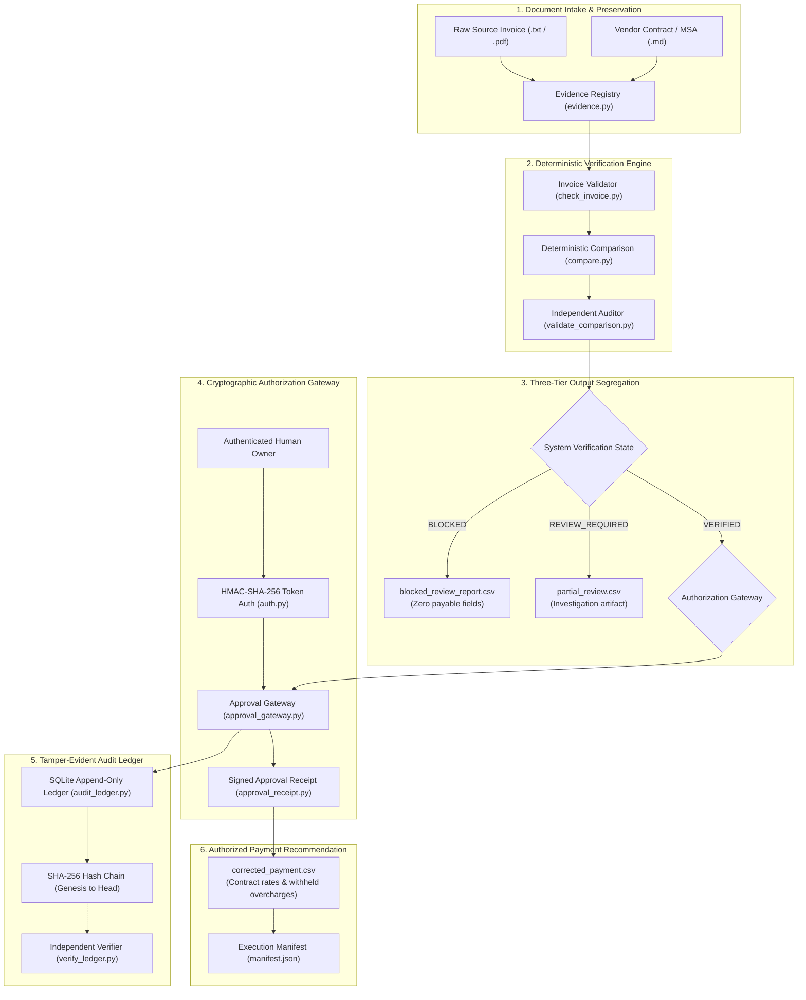
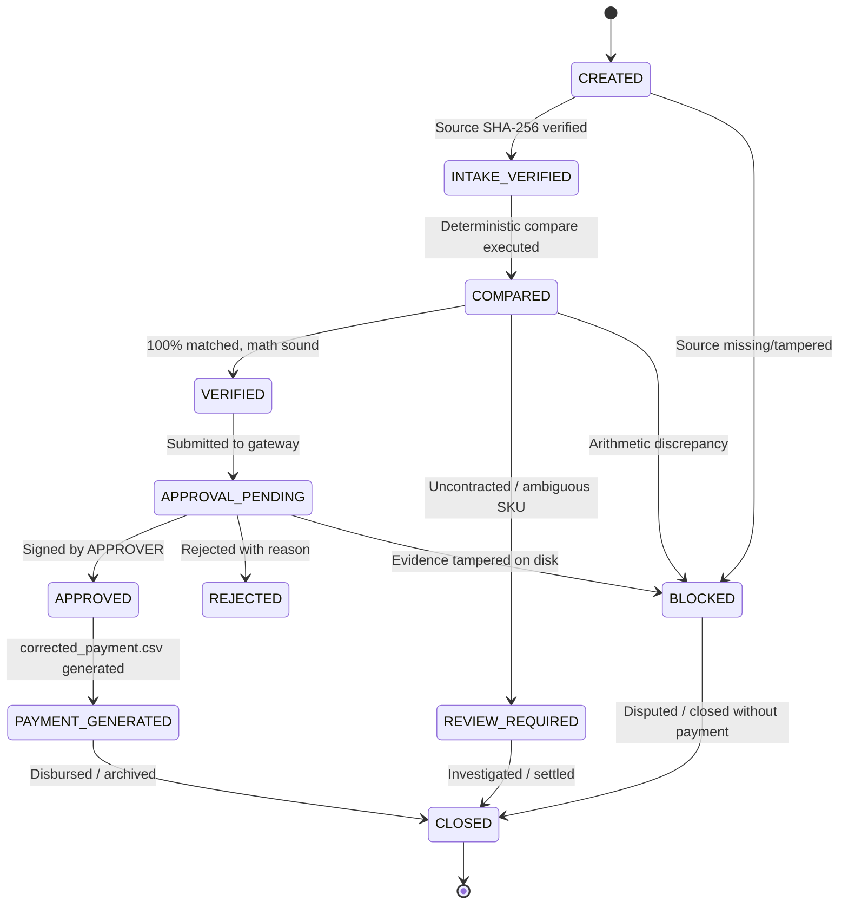

# ARCHITECTURE.md — Overcharge Desk Technical Architecture

> **System**: Overcharge Desk — Evidence-First Vendor Reconciliation & Cryptographic Payment Control  
> **Version**: 2.1.0  
> **Authority**: [AGENTS.md](file:///d:/overcharge%20files/AGENTS.md)

---

## 1. High-Level Architecture Overview

Overcharge Desk is designed as a **fail-closed, evidence-first payment control pipeline**. It separates non-deterministic language extraction from deterministic arithmetic verification, independent comparison auditing, cryptographic human authorization, and tamper-evident append-only ledgering.



---

## 2. Directory Structure & Case Organization

Cases are organized into standardized directories:

```text
cases/<case_id>/
├── case.json               # Case metadata, lifecycle history & state transitions
├── evidence_registry.json  # Cryptographic fingerprint registry of all intake files
├── source/                 # Preserved raw documents (immutable read-only)
├── normalized/             # Extracted JSON representations
├── comparison/             # Deterministic comparison outputs
│   ├── compare.json        # Schema 2.0.0 comparison result
│   └── compare.json.sha256 # Companion canonical SHA-256 digest
├── approvals/              # Human authorization records
│   └── approval_receipt.json # Signed HMAC-SHA-256 approval receipt
├── artifacts/              # Generated output CSVs
│   ├── corrected_payment.csv     (Tier 1: VERIFIED only)
│   ├── partial_review.csv        (Tier 2: REVIEW_REQUIRED only)
│   └── blocked_review_report.csv (Tier 3: BLOCKED only)
└── manifest.json           # Execution manifest for crash recovery & audit
```

---

## 3. Core Modules & Responsibilities

| Module | Core Responsibility | Enforced Invariant |
|---|---|---|
| [`tools/common.py`](file:///d:/overcharge%20files/tools/common.py) | Decimal utilities, safe rounding (`q2`), canonical serialization, path security. | Exact Decimal arithmetic, cross-platform path traversal rejection. |
| [`tools/check_invoice.py`](file:///d:/overcharge%20files/tools/check_invoice.py) | Structural schema inspection, source digest verification, arithmetic parity. | Discrepancy quarantine, source preservation. |
| [`tools/compare.py`](file:///d:/overcharge%20files/tools/compare.py) | Deterministic rate matching, SKU boundaries, rate-history selection, variance calculation. | Fail-closed blocking on math discrepancies; Schema 2.0.0 output. |
| [`tools/validate_comparison.py`](file:///d:/overcharge%20files/tools/validate_comparison.py) | Independent comparison auditor validating line-level parity and totals consistency. | Defense-in-depth against poisoned or malformed comparison JSON. |
| [`tools/evidence.py`](file:///d:/overcharge%20files/tools/evidence.py) | Registers and re-verifies raw files and artifacts via full 64-char SHA-256 digests. | Immutable source locators, tamper detection on disk. |
| [`tools/auth.py`](file:///d:/overcharge%20files/tools/auth.py) | Actor registry, role permissions, time-bound HMAC-SHA-256 token issuance. | Fail-closed authentication, strict role-based access control. |
| [`tools/approval_receipt.py`](file:///d:/overcharge%20files/tools/approval_receipt.py) | Generates and verifies cryptographic approval receipts binding all evidence digests. | Cryptographic binding of identity, decision, amounts, and hashes. |
| [`tools/approval_gateway.py`](file:///d:/overcharge%20files/tools/approval_gateway.py) | Validates approval requests, checks on-disk evidence, verifies amounts, signs receipts. | Strict gatekeeping: blocks approval on BLOCKED audits or amount mismatches. |
| [`tools/audit_ledger.py`](file:///d:/overcharge%20files/tools/audit_ledger.py) | SQLite transactional append-only ledger with continuous SHA-256 hash chaining. | Tamper-evident audit trail from genesis to head. |
| [`tools/verify_ledger.py`](file:///d:/overcharge%20files/tools/verify_ledger.py) | Traverses SQLite ledger verifying every sequence, previous hash, and payload hash. | Immediate detection of modified, deleted, or reordered records. |
| [`tools/pipeline.py`](file:///d:/overcharge%20files/tools/pipeline.py) | Controlled 13-stage verification, reconciliation, and payment authorization pipeline. | End-to-end orchestration, execution manifest generation, crash recovery. |

---

## 4. Case Lifecycle State Machine



---

## 5. Ledger Hash Chain Mechanics

Each event in the SQLite audit ledger (`ledger.db`) is cryptographically linked to its predecessor:

$$\text{EventHash}_n = \text{SHA-256}\left(\text{canonical}\left(\begin{aligned}
&\text{event\_id}_n, \, \text{seq}_n, \, \text{case\_id}_n, \, \text{event\_type}_n, \\
&\text{actor\_id}_n, \, \text{timestamp}_n, \, \text{payload}_n, \, \text{refs}_n, \, \text{EventHash}_{n-1}
\end{aligned}\right)\right)$$

- **Genesis**: Event 1 has $\text{EventHash}_0 = 0^{64}$ (64 hexadecimal zeros).
- **Append-Only Guarantee**: SQLite transactions with `BEGIN IMMEDIATE` ensure concurrent execution cannot create sequence gaps or fork the hash chain.
- **Verification Complexity**: $O(N)$ sequential scan recalculating and validating every link.


<!-- Invariant Note: Architecture adheres to AGENTS.md separation of financial math and prompts -->
