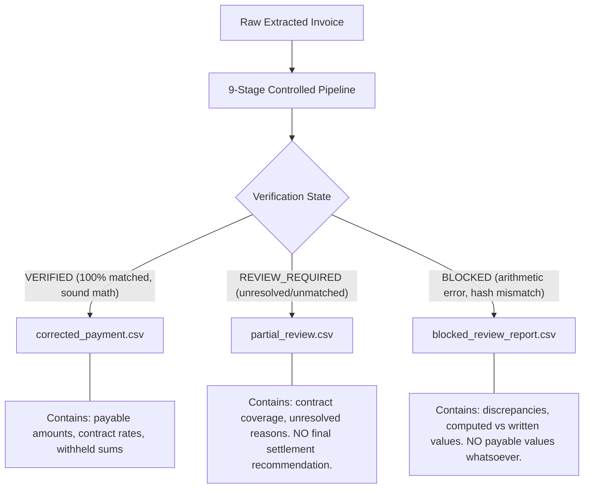

# FINANCIAL_BOUNDARY_MODEL.md — Financial Trust Boundaries & Output Controls

> **Version**: 2.1.0  
> **Status**: Active Operational Invariant  
> **Authority**: [AGENTS.md](file:///d:/overcharge%20files/AGENTS.md) and Phase 2.1 Boundary Audit

---

## 1. Executive Summary

Phase 2 established deterministic Decimal arithmetic and fail-closed handling for internal arithmetic discrepancies. Phase 2.1 closes the remaining **operational trust boundaries**: preventing downstream tools, user arguments, or AI agents from accidentally or intentionally transforming incomplete or blocked audits into payment recommendations.

---

## 2. The Three-Tier Artifact Boundary Model

To eliminate any ambiguity between an approved payment recommendation and an ongoing investigation, Overcharge Desk enforces a strict, mechanically separated three-tier artifact model:



### 2.1 Tier 1: `VERIFIED` $\to$ `corrected_payment.csv`
- **Tool**: [`tools/payment_sheet.py`](file:///d:/overcharge%20files/tools/payment_sheet.py)
- **Eligibility**: Invoices where:
  - System `verification_status == "VERIFIED"`
  - `blocking_issues` is completely empty
  - `source_discrepancy_count == 0`
  - `unmatched_line_count == 0`
  - `totals.complete == true`
- **Output**: Actionable draft payment sheet with contract payable amounts, withheld variances, and line-item notes.
- **Fail-Closed Rule**: If called on any audit that is `REVIEW_REQUIRED` or `BLOCKED`, `payment_sheet.py` strictly refuses and exits with code 2.

### 2.2 Tier 2: `REVIEW_REQUIRED` $\to$ `partial_review.csv`
- **Tool**: [`tools/partial_review.py`](file:///d:/overcharge%20files/tools/partial_review.py)
- **Eligibility**: Invoices with unresolved evidence (e.g., uncontracted items, ambiguous SKU descriptions, expired contract rates) but no internal arithmetic contradictions.
- **Output**: Investigation review artifact.
- **Strict Invariants**:
  - Unmatched items are kept distinct from contract-covered items.
  - Never presents itself as an approved or final payment recommendation.
  - Total banner explicitly states `TOTAL (REVIEW REQUIRED - INCOMPLETE EVIDENCE: N line(s) unverified)`.
  - Refuses to process `BLOCKED` audits (exits with code 2).

### 2.3 Tier 3: `BLOCKED` $\to$ `blocked_review_report.csv`
- **Tool**: [`tools/blocked_review_report.py`](file:///d:/overcharge%20files/tools/blocked_review_report.py)
- **Eligibility**: Invoices with material discrepancies, negative quantities, negative prices, missing source files, digest mismatches, or overlapping contract rates.
- **Output**: Pure discrepancy evidence report.
- **Strict Invariants**:
  - **Zero Payable Fields**: Contains NO payable columns, NO payable values, NO payment instructions, and NO recommended settlement.
  - Columns: `line_no`, `description`, `quantity`, `invoiced_unit_price`, `contract_unit_price`, `invoiced_line_total_as_written`, `invoiced_line_total_computed`, `discrepancy_reason`, `source_ref`, `verification_status`.
  - Total banner explicitly states `TOTAL (BLOCKED AUDIT - NO PAYMENT AUTHORIZATION)`.

---

## 3. Removal of Blocked-Draft Overrides

In earlier prototypes, `payment_sheet.py` supported an experimental flag:
```python
ap.add_argument("--allow-blocked-draft", action="store_true")
```
While this flag labeled the summary row as blocked, it still calculated payable amounts for other verified lines on the same invoice. This introduced a critical boundary flaw: an external caller or agent could invoke this flag to generate payable recommendations from an arithmetic failure.

**Action Taken**:
- The `--allow-blocked-draft` argument has been **completely removed**.
- A `BLOCKED` result can **never produce a payment recommendation under any circumstances**.
- Callers requiring discrepancy evidence must use `tools/blocked_review_report.py`, which is architecturally incapable of calculating or emitting payable recommendations.

---

## 4. Independent Comparison Result Validation (`validate_comparison.py`)

Downstream tools must not trust caller-supplied JSON merely because `ok: true` or `verification_status: "VERIFIED"`.

[`tools/validate_comparison.py`](file:///d:/overcharge%20files/tools/validate_comparison.py) executes deep, independent validation prior to downstream artifact generation:

1. **Schema 2.0.0 Structure**: Validates all top-level keys, ISO currency, and ISO dates.
2. **Line-Level Mathematical Parity**:
   $$\text{ComputedLineTotal} = \text{round}_{\text{half-up}}(\text{Quantity} \times \text{InvoicedUnitPrice}, 2)$$
   $$\text{ContractLineTotal} = \text{round}_{\text{half-up}}(\text{Quantity} \times \text{ContractUnitPrice}, 2)$$
   $$\text{LineVariance} = \text{round}_{\text{half-up}}(\text{Quantity} \times (\text{InvoicedUnitPrice} - \text{ContractUnitPrice}), 2)$$
3. **Totals Reconciliation**:
   $$\sum \text{LineVariance} == \text{totals.variance\_on\_matched\_lines}$$
   $$\sum \text{ComputedLineTotal} == \text{totals.matched\_invoiced}$$
   $$\sum \text{ContractLineTotal} == \text{totals.matched\_per\_contract}$$
4. **State Coherence**:
   - If discrepancies exist or `blocking_issues` is non-empty, `verification_status` MUST be `BLOCKED`.
   - If `verification_status == "VERIFIED"`, `blocking_issues` must be empty, discrepancy count must be 0, unmatched count must be 0, and `totals.complete` must be `true`.
   - If `verification_status == "REVIEW_REQUIRED"`, discrepancy count must be 0, blocking issues must be empty, and unmatched count must be $> 0$.

---

## 5. Audit Integrity & Cryptographic Digests

### 5.1 Canonical Serialization
To ensure byte-for-byte reproducibility:
- `canonical_json_bytes(obj)` serializes comparison results using sorted keys, UTF-8 encoding, and compact separators (`separators=(',', ':')`).
- `hash_comparison_result(obj)` computes the full 64-character SHA-256 hex digest.

### 5.2 Companion Digest Files
- When saving comparisons, [`tools/compare.py`](file:///d:/overcharge%20files/tools/compare.py) (via `--save-digest` or [`tools/pipeline.py`](file:///d:/overcharge%20files/tools/pipeline.py)) writes:
  - `<compare>.json`
  - `<compare>.json.sha256`
- Downstream tools verify that the recorded digest matches the re-computed canonical hash of the JSON file before processing.

### 5.3 Honest Trust Limitations
> [!IMPORTANT]
> A SHA-256 companion digest stored alongside a JSON file on a local filesystem proves **artifact integrity** (that the file was not accidentally corrupted or edited without recomputing the digest). It does **not prove user identity**, nor does it prevent an attacker with full filesystem access from modifying both the JSON and the `.sha256` companion file simultaneously. Cryptographic actor identity, asymmetric signing, and immutable ledger bindings are addressed in subsequent phases.

---

## 6. In-Engine Source Validation & Cross-Platform Path Security

### 6.1 Direct Enforcement in `compare.py`
Previously, `check_invoice.py` performed source fingerprint validation, but `compare.py` did not. This created a potential bypass if an agent invoked `compare.py` directly without validating source integrity.

Under Phase 2.1:
- [`tools/compare.py`](file:///d:/overcharge%20files/tools/compare.py) directly inspects `source_file` and `source_sha256`.
- It verifies that the file exists on disk and recalculates its SHA-256 digest.
- Any digest mismatch, missing file, or unsafe path immediately appends to `blocking_issues` and sets `verification_status: "BLOCKED"`.
- It is impossible to obtain a `VERIFIED` comparison result from an unverified or mismatched source file.

### 6.2 Cross-Platform Path Traversal Prevention
[`tools/common.py:is_safe_relative_path()`](file:///d:/overcharge%20files/tools/common.py#L149) normalizes path separators (`\` and `/`) to prevent cross-platform traversal exploits:
- Traversal via backslashes on POSIX systems (e.g. `..\..\etc\passwd`) is recognized and blocked.
- Traversal via forward slashes on Windows systems (e.g. `../../etc/passwd`) is recognized and blocked.
- Absolute paths (`/etc/passwd`, `C:\Windows\...`, `\\server\share\...`) are rejected.
- Paths containing Windows drive colons or Alternate Data Streams (`:`) are rejected.

---

## 7. The 9-Stage Controlled Reconciliation Pipeline

[`tools/pipeline.py`](file:///d:/overcharge%20files/tools/pipeline.py) orchestrates the end-to-end reconciliation flow:

| Stage | Operation | Enforcing Mechanism |
|---|---|---|
| 1 | Load Invoice | `load_json()` |
| 2 | Validate Schema & Structure | `check_invoice.find_issues()` |
| 3 | Path Safety Verification | `is_safe_relative_path()` |
| 4 | Source File Existence Check | `src_path.is_file()` |
| 5 | SHA-256 Recalculation | `sha256_file()` |
| 6 | Digest Parity Check | `calc.lower() == declared.lower()` |
| 7 | Deterministic Rate Comparison | `compare()` |
| 8 | Canonical Digest & Schema Validation | `save_comparison_with_digest()` & `validate_comparison()` |
| 9 | Authorized Artifact Generation | `payment_sheet.py` (`VERIFIED`), `partial_review.py` (`REVIEW_REQUIRED`), or `blocked_review_report.py` (`BLOCKED`) |
