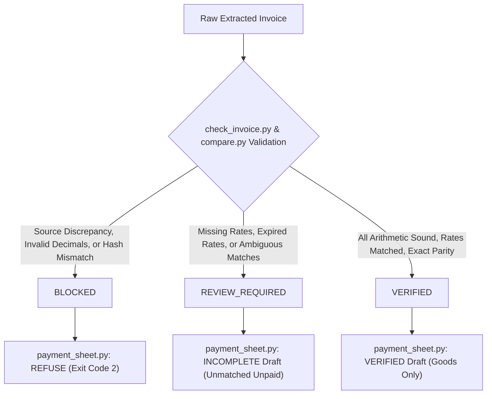

# FINANCIAL_VERIFICATION.md — Overcharge Desk Financial Engine Specification

> **Version**: 2.0.0  
> **Status**: Active Engineering Standard  
> **Authority**: Invariant rules codified in [AGENTS.md](file:///d:/overcharge%20files/AGENTS.md) and executed by `tools/`

---

## 1. Executive Overview

Overcharge Desk is an evidence-first vendor reconciliation and dispute engine. Its primary operational requirement is absolute financial determinism: **every financial calculation, status, and payment recommendation must be mathematically provable, traceable to source documents, and fail-closed whenever evidence is contradictory, missing, or corrupt.**

This document provides the formal mathematical and algorithmic specification for the financial verification engine implemented in:
- [`tools/common.py`](file:///d:/overcharge%20files/tools/common.py)
- [`tools/compare.py`](file:///d:/overcharge%20files/tools/compare.py)
- [`tools/check_invoice.py`](file:///d:/overcharge%20files/tools/check_invoice.py)
- [`tools/payment_sheet.py`](file:///d:/overcharge%20files/tools/payment_sheet.py)

---

## 2. Core Arithmetic & Quantization Rules

### 2.1 Mandatory Exact Decimal Arithmetic
- **Strict Prohibition of Float**: IEEE 754 floating-point numbers (`float`) are completely prohibited in financial calculations, comparisons, and internal representations.
- **Python `decimal.Decimal`**: All monetary amounts, unit rates, quantities, and line totals are parsed and manipulated strictly as `Decimal` instances via `to_decimal(val, what)`.
- **Arbitrary Precision Support**: The engine safely processes arbitrarily large transactions (e.g., hundreds of billions) and microscopic unit rates without precision decay or overflow artifacts.

### 2.2 Explicit Rounding Policy
- **Quantization Constant**: `CENT = Decimal("0.01")`
- **Rounding Mode**: `ROUND_HALF_UP` (Half-Up rounding, rounding halves towards nearest infinity; e.g. 0.0050 rounds to 0.01, 0.0250 rounds to 0.03, rather than banker's rounding).
- **Line-Level Quantization**:
  $$\text{ComputedLineTotal} = \text{round}_{\text{half-up}}(\text{Quantity} \times \text{InvoicedUnitPrice}, 2)$$
  $$\text{ContractLineTotal} = \text{round}_{\text{half-up}}(\text{Quantity} \times \text{ContractUnitPrice}, 2)$$
  $$\text{LineVariance} = \text{round}_{\text{half-up}}(\text{Quantity} \times (\text{InvoicedUnitPrice} - \text{ContractUnitPrice}), 2)$$
- **Total Aggregation**: Totals are strictly computed by summing already quantized line-level records. Totals are never rounded independently to disguise line-level discrepancies.

---

## 3. Verification State Machine

The verification engine separates **system-level verification states** from **line-level statuses** and **variance directions**.



### 3.1 System-Level Verification States (`verification_status`)

| State | Definition | Impact on Settlement |
|---|---|---|
| `VERIFIED` | All lines have sound arithmetic, valid dates, active contract rates, and stated totals match the sum of written lines. | Normal goods subtotal reconciliation generated. Eligible for owner review. |
| `REVIEW_REQUIRED` | Evidence is incomplete (e.g., unmatched items, ambiguous descriptions, rate expired). No direct source contradictions found. | Partial draft sheet generated with unmistakable `INCOMPLETE` banner. Unmatched lines left unpaid. |
| `BLOCKED` | Material discrepancy or integrity failure detected (e.g., internal arithmetic mismatch, negative price/quantity, corrupted SHA-256, overlapping rates). | **Fail-Closed**: Automated payment recommendations are strictly blocked. CLI exits with code 2. |

### 3.2 Line-Level Statuses (`verification_status` and `status`)

| Line Status | System Constant | Meaning |
|---|---|---|
| `VERIFIED_MATCH` | `STATUS_VERIFIED_MATCH` | Invoiced unit price matches contract unit price exactly ($Variance = 0.00$). |
| `VERIFIED_OVERCHARGE` | `STATUS_VERIFIED_OVERCHARGE` | Invoiced unit price exceeds contract unit price ($Variance > 0.00$). Contract amount payable; variance withheld. |
| `VERIFIED_UNDERCHARGE` | `STATUS_VERIFIED_UNDERCHARGE` | Invoiced unit price is below contract unit price ($Variance < 0.00$). Invoiced amount payable; zero withheld. |
| `SOURCE_DISCREPANCY` | `STATUS_SOURCE_DISCREPANCY` | Line arithmetic fails ($\text{Qty} \times \text{Price} \neq \text{WrittenLineTotal}$) or invalid numerical data. **Causes System `BLOCKED`**. |
| `UNMATCHED` | `STATUS_UNMATCHED` | Line description does not match a contract SKU, is ambiguous, or no rate is in force for the date. **Causes System `REVIEW_REQUIRED`**. |
| `REQUIRES_HUMAN_REVIEW` | `STATUS_REQUIRES_HUMAN_REVIEW` | Line requires explicit human adjudication before reconciliation. |

---

## 4. Source-Integrity & Input Hardening

### 4.1 SHA-256 Source Digest Verification
- At intake, raw invoice text is cryptographically hashed (`tools/sha.py`).
- During `tools/check_invoice.py` execution, the engine resolves the referenced `source_file`, verifies its existence, recalculates its full 64-character SHA-256 digest, and compares it with `source_sha256`.
- **Any digest mismatch reports an explicit issue and blocks automated processing.**

### 4.2 Path Traversal Prevention
- All relative paths for source files and case directories are validated through `is_safe_relative_path(path)`.
- Traversal components (`..`, `./`, leading slashes, Windows drive roots `C:\`, UNC paths) are rejected outright.

### 4.3 Input Validation Boundary
The engine validates all top-level and line-level inputs:
- `case_id`: Strict format `OC-YYYYMMDD-NN` via regex.
- `currency`: 3-letter ISO code (e.g., `INR`, `USD`). Currency conversions are strictly refused.
- `quantity`: Must be strictly positive ($Qty > 0$). Negative quantities and zero quantities are rejected as invalid line data.
- `unit_price`: Must be non-negative ($Price \ge 0$). Negative prices are rejected.
- `line_total`: Must be non-negative ($Total \ge 0$).
- `line_no`: Must be unique across all lines within an invoice. Duplicate line numbers cause `BLOCKED`.
- Non-finite numbers (`NaN`, `Infinity`, `-Infinity`) and malformed numeric strings raise `ToolError` and block processing.

---

## 5. Contract Matching & Ambiguity Resolution

Contract rate lookups follow strict deterministic precedence:
1. **Explicit SKU Boundary Matching**:
   - Matching inspects words and word-boundary tokens in invoice descriptions against contract SKU patterns.
   - Substring confusion is prevented (e.g., `CC-5` does not match `CC-50` or `CC-5-EXTRA`).
2. **Ambiguity Quarantine**:
   - If an invoice description matches multiple distinct contract items (e.g., `"CC-5 carton with PW-1 pallet wrap"`), the engine **refuses to pick one arbitrarily**. The line is quarantined as `UNMATCHED` with reason `"description matches more than one contract item"`.
3. **Date-Effective Rate Resolution**:
   - Contract rates define `effective_from` and optional `effective_to`.
   - The invoice date must satisfy: $\text{effective\_from} \le \text{invoice\_date} \le \text{effective\_to}$.
   - If no rate was in force, the line is quarantined as `UNMATCHED` (`"no rate in effect on YYYY-MM-DD"`).
   - If contract history contains multiple overlapping rates for the same item on the invoice date, the engine records an integrity error and sets system status to `BLOCKED`.

---

## 6. Discrepancy Handling & Fail-Closed Policies

### 6.1 Source Arithmetic Discrepancy (Critical Invariant)
When an invoice line contains an internal mismatch:
$$\text{round}_{\text{half-up}}(\text{Quantity} \times \text{InvoicedUnitPrice}, 2) \neq \text{InvoicedLineTotalAsWritten}$$
1. The line is assigned status `SOURCE_DISCREPANCY` with `blocking: true`.
2. Both values (`invoiced_line_total_as_written` and `invoiced_line_total_computed`) are preserved verbatim.
3. System `verification_status` is locked to `BLOCKED`.
4. `settlement_status` is set to `"PAYMENT_RECOMMENDATION_BLOCKED: SOURCE_DISCREPANCY"`.
5. `payment_sheet.py` strictly refuses to generate an approval payment CSV (process exits with code 2).

### 6.2 Stated Total Discrepancy
$$\sum_{i} \text{InvoicedLineTotalAsWritten}_i \neq \text{StatedTotalAsWritten}$$
If the stated invoice subtotal does not equal the arithmetic sum of the line totals as written:
1. The mismatch is recorded in `blocking_issues`.
2. `totals.stated_total_matches` is marked `false`.
3. System `verification_status` is locked to `BLOCKED`.
4. Downstream payment recommendations are blocked.

---

## 7. Payment Recommendation Generation (`payment_sheet.py`)

The payment sheet generator is a read-only transformation tool that translates a verified comparison result into a human-reviewable CSV artifact:

1. **Refusal on Blocked Input**:
   - If `verification_status == "BLOCKED"` or `blocking_issues` is non-empty, `build_rows()` raises `ToolError` with exit code 2.
2. **Payment Allocation Logic**:
   - **Over-billed Line**: Pays contract rate ($\text{Quantity} \times \text{ContractUnitPrice}$); withholds difference ($\text{LineVariance}$).
   - **Under-billed Line**: Pays as invoiced ($\text{Quantity} \times \text{InvoicedUnitPrice}$); withholds 0.00.
   - **Matched Line**: Pays as invoiced; withholds 0.00.
   - **Unmatched Line**: Payable is left blank (`""`); note explicitly marks `"UNVERIFIED - UNMATCHED"`.
3. **Formula Injection Sanitization (`safe_text`)**:
   - Any text cell beginning with formula prefix characters (`=`, `+`, `-`, `@`, `\t`, `\r`) is automatically prepended with a single quote `'` to prevent spreadsheet code execution.
4. **Subtotal Labeling**:
   - Summary row explicitly states `TOTAL (GOODS ONLY - VERIFIED)` or `TOTAL (GOODS ONLY - INCOMPLETE: N line(s) unverified)`.
   - Footer note explicitly warns: `"Draft for owner review. No payment made. Taxes and freight are unverified per contract terms."`
   - Setting `taxes_and_freight_unverified: true` guarantees no claim of full invoice settlement is made.

---

## 8. Versioned Output Schema (`v2.0.0`)

The output schema emitted by `compare.py` is fully versioned and strictly structured:

```json
{
  "ok": true,
  "schema_version": "2.0.0",
  "verification_status": "VERIFIED | REVIEW_REQUIRED | BLOCKED",
  "settlement_status": "GOODS_SUBTOTAL_RECONCILED: TAX_AND_FREIGHT_UNVERIFIED | PAYMENT_RECOMMENDATION_PARTIAL: UNRESOLVED_LINES | PAYMENT_RECOMMENDATION_BLOCKED: SOURCE_DISCREPANCY",
  "case_id": "OC-20261106-01",
  "vendor_id": "acme",
  "contract_id": "ACME-2026-01",
  "invoice_number": "INV-1103",
  "invoice_date": "2026-11-03",
  "currency": "INR",
  "rounding": "half-up to 2 decimals per line; totals add the rounded lines",
  "taxes_and_freight_unverified": true,
  "lines": [
    {
      "line_no": 1,
      "description": "Corrugated carton, 5-ply (CC-5)",
      "source_ref": "invoices/acme-inv-1103.txt, line 1",
      "status": "matched",
      "verification_status": "VERIFIED_OVERCHARGE",
      "contract_matching_status": "matched",
      "source_arithmetic_status": "VERIFIED",
      "item_key": "carton-cc5",
      "clause_ref": "Schedule A, item 1",
      "quantity": "500",
      "unit": "unit",
      "invoiced_unit_price": "112.00",
      "contract_unit_price": "100.00",
      "variance_per_unit": "12.00",
      "line_variance": "6000.00",
      "variance_pct": "12.00",
      "direction": "over",
      "contract_line_total": "50000.00",
      "invoiced_line_total_computed": "56000.00",
      "invoiced_line_total_as_written": "56000.00",
      "line_total_matches": true
    }
  ],
  "totals": {
    "complete": true,
    "verification_status": "VERIFIED",
    "matched_invoiced": "66000.00",
    "matched_per_contract": "60000.00",
    "variance_on_matched_lines": "6000.00",
    "verified_overcharge_total": "6000.00",
    "verified_undercharge_total": "0.00",
    "unmatched_invoiced_as_written": "0.00",
    "invoiced_total": "66000.00",
    "per_contract_total": "60000.00",
    "goods_subtotal_invoiced_written": "66000.00",
    "goods_subtotal_contract": "60000.00",
    "stated_total_as_written": "66000.00",
    "sum_of_line_totals_as_written": "66000.00",
    "stated_total_matches": true,
    "source_discrepancy_count": 0,
    "unmatched_line_count": 0
  },
  "blocking_issues": [],
  "unresolved_evidence": [],
  "warnings": []
}
```

---

## 9. Adversarial Verification Matrix

The test suite [`tests/test_financial_adversarial.py`](file:///d:/overcharge%20files/tests/test_financial_adversarial.py) tests all 35 operational and adversarial boundary conditions:

| Scenario # | Description | Expected Verification State | Fail-Closed Guarantee |
|---|---|---|---|
| 01 | Correct invoice | `VERIFIED` | Full mathematical reconciliation |
| 02 | Contract overcharge | `VERIFIED` | Withholds ₹6,000 variance |
| 03 | Contract undercharge | `VERIFIED` | Pays invoiced amount; 0 withheld |
| 04 | Exact contract match | `VERIFIED` | Net variance ₹0.00 |
| 05 | Line total mismatch | `BLOCKED` | `payment_sheet.py` blocked (Exit 2) |
| 06 | Stated total mismatch | `BLOCKED` | `payment_sheet.py` blocked (Exit 2) |
| 07 | Missing line total | Incomplete source | Flagged in `check_invoice` |
| 08 | Missing quantity | `REVIEW_REQUIRED` | Line isolated as `UNMATCHED` |
| 09 | Zero quantity | `BLOCKED` | Quantity must be positive |
| 10 | Negative quantity | `BLOCKED` | Rejected; cannot be negative |
| 11 | Negative unit price | `BLOCKED` | Rejected; cannot be negative |
| 12 | Non-finite input (`NaN`, `Inf`) | `BLOCKED` | Trapped by `to_decimal` |
| 13 | Invalid numeric string | `BLOCKED` | Trapped by `to_decimal` |
| 14 | Duplicate line identifiers | `BLOCKED` | Rejected; uniqueness enforced |
| 15 | Unknown SKU | `REVIEW_REQUIRED` | Quarantined as `UNMATCHED` |
| 16 | Ambiguous SKU | `REVIEW_REQUIRED` | Quarantined as `UNMATCHED` |
| 17 | Expired contract rate | `REVIEW_REQUIRED` | Quarantined as `UNMATCHED` |
| 18 | Future contract rate | `REVIEW_REQUIRED` | Quarantined as `UNMATCHED` |
| 19 | Overlapping contract rates | `BLOCKED` | Ambiguous contract rejected |
| 20 | Currency mismatch | ToolError (code 3) | Multi-currency conversions refused |
| 21 | Missing currency | ToolError (code 3) | Refuses to guess currency |
| 22 | Source file missing | Discrepancy issue | File verification fails |
| 23 | Source fingerprint mismatch | Discrepancy issue | Digest mismatch caught |
| 24 | Path traversal attempt | Path security error | Traversal rejected |
| 25 | Mixed matched/unmatched items | `REVIEW_REQUIRED` | Payment sheet incomplete; unmatched unpaid |
| 26 | Multiple discrepancies | `BLOCKED` | All discrepancies logged |
| 27 | Rounding boundary cases | N/A | Exact half-up rounding tested |
| 28 | Very large monetary values | `VERIFIED` | Zero float overflow artifacts |
| 29 | Very small monetary values | `VERIFIED` | Exact sub-cent math |
| 30 | Formula injection payload | Sanitized | Escaped with `'` prefix |
| 31 | Malformed comparison JSON | ToolError | Downstream rejection |
| 32 | Tampered comparison result | ToolError (code 2) | Refuses payment generation |
| 33 | Payment sheet on blocked audit | ToolError (code 2) | Hard block |
| 34 | Payment sheet on incomplete audit | Review draft | Labeled `TOTAL (GOODS ONLY - INCOMPLETE)` |
| 35 | Goods subtotal completeness | Goods-only | `taxes_and_freight_unverified: true` |
