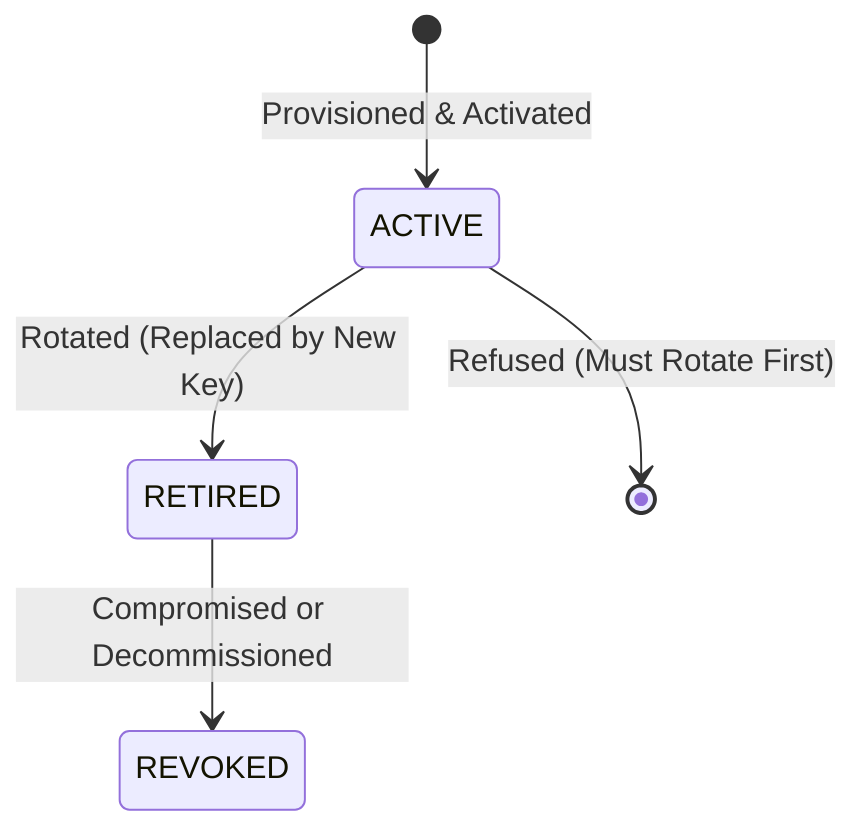

# Overcharge Desk — Cryptographic Key Management & Lifecycle

> **Status**: Production Key Management Baseline (Phase 3.2)  
> **Audience**: Cryptography Engineers, Platform Operations, Security Officers

This specification defines the lifecycle, storage, rotation, and historical verification policies for cryptographic signing keys in Overcharge Desk.

---

## 1. Cryptographic Standard & Scope

Overcharge Desk utilizes **HMAC-SHA-256** for signing approval receipts, ledger checkpoints, and audit export manifests.
- **Key Material**: 32-byte (256-bit) cryptographically random symmetric keys, formatted on disk as 64-character lowercase hexadecimal strings.
- **Scope**:
  1. Human approval receipts (`approval_receipt.json`).
  2. Audit ledger checkpoints (`checkpoints.jsonl`).
  3. Standalone case audit packages (`manifest.json.sig`).

---

## 2. Key Lifecycle States

Every cryptographic key managed by `KeyManager` transitions through explicit lifecycle states:



1. **`ACTIVE`**:
   - Exactly one key is active for new signatures at any given time.
   - All newly generated receipts and checkpoints use `active_key_id`.
2. **`RETIRED`**:
   - The key is no longer used for new signatures.
   - Key material is preserved on disk to enable deterministic historical verification of past receipts and ledger checkpoints.
3. **`REVOKED`**:
   - The key has been flagged as compromised.
   - Active keys cannot be revoked directly; they must first be replaced via key rotation.
   - Receipts signed with revoked keys are flagged as unverified or disputed.

---

## 3. Storage & Permission Invariants

### 3.1 Key Storage Architecture
- Keys reside in `config/` named by key identifier: `config/<key_id>.key`.
- Metadata is tracked in `config/keys_manifest.json`:
```json
{
  "active_key_id": "key-20261105-a8f2",
  "keys": [
    {
      "key_id": "key-20261105-a8f2",
      "status": "ACTIVE",
      "algorithm": "HMAC-SHA-256",
      "created_at": "2026-11-05T08:00:00Z",
      "activated_at": "2026-11-05T08:00:00Z"
    },
    {
      "key_id": "key-2026-01",
      "status": "RETIRED",
      "algorithm": "HMAC-SHA-256",
      "created_at": "2026-01-01T00:00:00Z",
      "activated_at": "2026-01-01T00:00:00Z",
      "retired_at": "2026-11-05T08:00:00Z"
    }
  ]
}
```

### 3.2 Production Fail-Closed Gates
When `APP_ENV=production`:
- **No In-Memory Fallbacks**: Hardcoded default keys (e.g. `b"0123456789abcdef..."`) are completely forbidden. If `config/keys_manifest.json` or the active key file is missing, the application refuses to start (`ToolError`, exit code 4).
- **Strict File Permissions**: On POSIX systems, signing key files must have strict `0600` permissions (`-rw-------`). Startup fails immediately if group or other read/write permissions are detected.

---

## 4. Key Rotation & Historical Verification

### 4.1 Rotation Routine
Key rotation is executed without service downtime:
1. `KeyManager.rotate_key()` generates a fresh 256-bit cryptographically secure key.
2. The current active key is updated to status `RETIRED` with an immutable `retired_at` timestamp.
3. The new key is set to `ACTIVE`.
4. The atomic manifest write ensures no half-written key state can be read.

### 4.2 Historical Verification Integrity
Because all approval receipts record their binding `signing_key_id`, verification routines look up the specific key used at the time of signing:
```python
key_bytes = key_manager.get_key_by_id(receipt["signing_key_id"])
```
This guarantees that rotating signing keys does not invalidate previously approved receipts or historical ledger entries.

