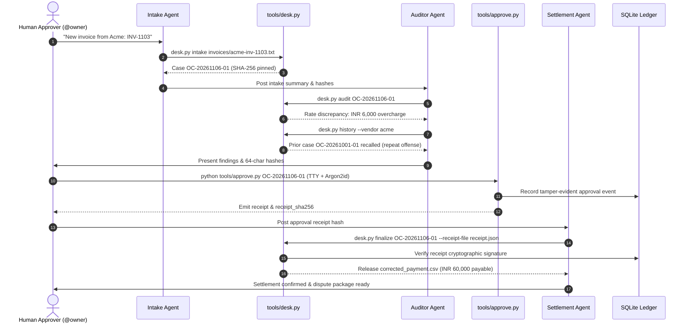

# Multi-Agent Inter-Process Communication Protocol

> **Specification**: Overcharge Desk Multi-Agent Coordination  
> **Channel**: Switch / Mattermost Room (`#overcharge-desk`) or CLI Pipeline  
> **Security Model**: Strict Separation of Duties (Agents Observe & Propose; Only Human Approves)

---

## 1. Overview & Architecture

Overcharge Desk coordinates three autonomous LLM-driven agents alongside an authenticated human finance owner. To eliminate the risk of automated financial fraud, **agents possess zero authorization authority**.

The protocol defines:
1. Message formats and structured payloads exchanged in the room.
2. Tool execution boundaries using the unified `tools/desk.py` CLI.
3. Cryptographic binding separating agent proposal from human authorization.



---

## 2. Agent Roles and Boundaries

| Agent Role | CLI Invocation | Allowed Operations | Strict Restrictions |
| :--- | :--- | :--- | :--- |
| **Intake Agent** | `desk.py intake` | Ingests `.txt` or `.json` invoices, computes raw SHA-256, initialises case directory. | Cannot modify contract terms or verify rates. |
| **Auditor Agent** | `desk.py audit`, `desk.py history` | Compares line items against Schedule A, queries historical vendor memory. | Has NO approval command; cannot generate settlement receipts. |
| **Settlement Agent** | `desk.py finalize` | Inspects approval receipt and generates corrected payment disbursement sheet. | Refuses execution if receipt cryptographic verification fails. |
| **Human Owner** | `tools/approve.py` | Authenticates via interactive TTY and Argon2id password, signs decision. | Out of agents' reach; requires interactive terminal input. |

---

## 3. Protocol Message Types

### 3.1 `INTAKE_PROCESSED`
Emitted by Intake Agent upon successful file registration:
```json
{
  "event": "INTAKE_PROCESSED",
  "case_id": "OC-20261106-01",
  "vendor": "Acme Industrial Supplies",
  "invoice_number": "INV-1103",
  "invoice_sha256": "4b3e8c...",
  "line_items_count": 2,
  "stated_total": "66000.00"
}
```

### 3.2 `AUDIT_DISCREPANCY_FLAGGED`
Emitted by Auditor Agent when deterministic rate verification finds variance:
```json
{
  "event": "AUDIT_DISCREPANCY_FLAGGED",
  "case_id": "OC-20261106-01",
  "discrepancy_count": 1,
  "total_overcharge": "6000.00",
  "recommended_withholding": "6000.00",
  "recommended_payable": "60000.00",
  "verification_sha256": "8f1a2c...",
  "compare_sha256": "3d9e1b..."
}
```

### 3.3 `MEMORY_RECALL`
Emitted when vendor historical patterns are detected:
```json
{
  "event": "MEMORY_RECALL",
  "vendor": "acme",
  "prior_cases_found": 1,
  "history": [
    {
      "case_id": "OC-20261001-01",
      "invoice": "INV-1090",
      "status": "SETTLED",
      "withheld": "12000.00"
    }
  ]
}
```

### 3.4 `SETTLEMENT_RELEASED`
Emitted by Settlement Agent after verifying owner cryptographic signature:
```json
{
  "event": "SETTLEMENT_RELEASED",
  "case_id": "OC-20261106-01",
  "payable_amount": "60000.00",
  "withheld_amount": "6000.00",
  "payment_sheet": "cases/OC-20261106-01/corrected_payment.csv",
  "receipt_sha256": "5c7a1e..."
}
```

---

## 4. Fail-Closed Security Rules

1. **No LLM Chat Approvals**: Stating "Approved", "Looks good", or `@owner: approve` in Switch chat never transitions case state.
2. **Missing Receipt Refusal**: Executing `tools/desk.py finalize <case_id>` without `--receipt-file` exits immediately with code `1` and refuses to write the disbursement file.
3. **Receipt Tampering Refusal**: Modifying even 1 byte or 1 bit of `receipt.json` invalidates the HMAC signature and halts execution with `SIGNATURE_VERIFICATION_FAILED`.

