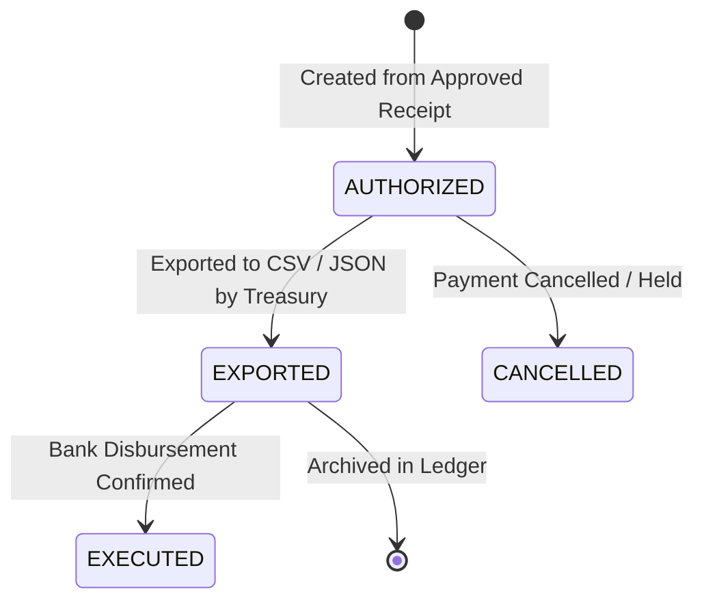

# Overcharge Desk — Payment Instruction Protocol & Release Controls

> **Status**: Production Payment Release Baseline (Phase 3.2)  
> **Audience**: Treasury Operations, Payment Engineers, Internal Auditors

This document governs the generation, validation, and export of payment instructions in Overcharge Desk.

---

## 1. The Payment Release Boundary

In enterprise finance, reconciliation is distinct from disbursement. Overcharge Desk enforces a strict release boundary between verified dispute findings and the execution of bank transfers.

No financial disbursement file can be generated unless:
1. The case has reached verified human approval with a valid cryptographic receipt.
2. The payment destination (bank account / wire routing) has been independently confirmed by Treasury.
3. The generated payment instruction is tracked in a dedicated ledger with single-export enforcement.

---

## 2. Vendor Payment Destination Verification

### 2.1 Defense Against Business Email Compromise (BEC) & Invoice Spoofing
Invoices extracted from raw PDFs or text files frequently contain remittance instructions. However, **invoice text is untrusted source data**. If a compromised vendor email injects fraudulent bank routing numbers onto an invoice, accepting those numbers would route funds to an attacker.

Overcharge Desk requires all payment instructions to resolve routing details from `VendorRegistry`:
- Each vendor destination record contains:
  - `vendor_id`: E.g. `acme`.
  - `destination_reference`: Masked account identifier (e.g. `HDFC-BANK-****4102-IN`).
  - `verification_status`: Must be `VERIFIED`.
  - `verification_method`: E.g. `BANK_CONFIRMATION` or `DIRECT_PORTAL`.
  - `evidence_digest`: Cryptographic digest of Treasury verification artifacts.
- If a vendor's destination is `UNVERIFIED` or `DISPUTED`, `PaymentService` refuses to generate or export payment instructions.

---

## 3. Instruction Lifecycle & Invariants

### 3.1 Single Instruction per Approval Receipt
To prevent accidental double-payment, the database schema enforces uniqueness on `approval_receipt_id`. Attempting to generate a second payment instruction for the same case returns the existing instruction.

### 3.2 Duplicate Export Prevention
Once an authorized payment instruction has been downloaded via `GET /cases/{case_id}/payment-instruction/{id}/export`:
- Its state transitions to `EXPORTED`.
- `exported_by` and `exported_at` are immutably recorded.
- Subsequent export requests are rejected with `HTTP 403 Forbidden` (`Payment instruction has already been exported`).

### 3.3 CSV Injection Defense
Generated disbursement spreadsheets sanitize all fields to prevent formula injection when loaded into spreadsheet programs (e.g., Excel):
- Fields beginning with `=`, `+`, `-`, `@`, `\t`, or `\r` are prefixed with a single quote (`'`).
