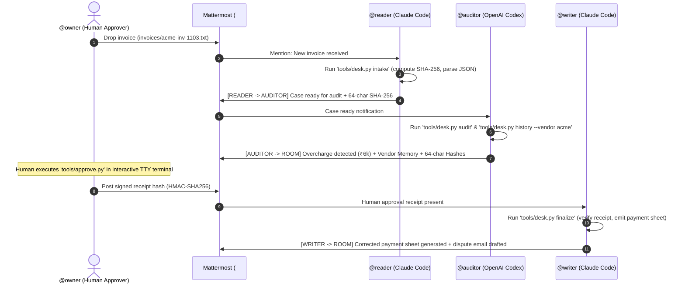

# Switch & Mattermost Multi-Agent Integration Guide

> **Project**: Overcharge Desk  
> **Environment**: Switch Platform / Mattermost Collaborative Team Channel  
> **Channel**: `#overcharge-desk`

---

## 1. Overview

Overcharge Desk deploys three specialized AI agents inside a shared Mattermost channel (`#overcharge-desk`) powered by the **Switch** multi-agent orchestration runtime:

```
                 Mattermost Room (#overcharge-desk)
           ┌─────────────────────┼─────────────────────┐
           ▼                     ▼                     ▼
    [ READER AGENT ]     [ AUDITOR AGENT ]     [ WRITER AGENT ]
    (tools/desk.py        (tools/desk.py        (tools/desk.py
     intake)               audit, history)       finalize)
           │                     │                     │
           └─────────────────────┼─────────────────────┘
                                 ▼
                    [ DETERMINISTIC ENGINE ]
                  Exact Decimals | Stage 8 Math
                                 │
                                 ▼
                    [ HUMAN APPROVAL GATE ]
               (tools/approve.py via Owner TTY)
```

---

## 2. Participant Configuration

### A. Bot User Creation
Create three bot accounts in the Mattermost System Console:
1. `reader-agent` (Display: `Reader Agent`, Role: Member)
2. `auditor-agent` (Display: `Auditor Agent`, Role: Member)
3. `writer-agent` (Display: `Writer Agent`, Role: Member)

### B. Channel Setup
1. Create a public or private team channel named `#overcharge-desk`.
2. Add `@reader`, `@auditor`, `@writer`, and the business financial owner account (`@owner`).

### C. Agent Prompt Ingestion
In the Switch Console, paste each agent's system prompt from the repository:
- **Reader Agent**: `agents/READER.md`
- **Auditor Agent**: `agents/AUDITOR.md`
- **Writer Agent**: `agents/WRITER.md`

All agents must share the same repository clone as their working directory.

---

## 3. Four-Turn Multi-Agent Protocol



---

## 4. Slash Commands & Webhooks (Optional)

Switch supports incoming webhooks and slash commands:

| Command | Action | Execution |
|---|---|---|
| `/desk-status <case_id>` | Query 4D case lifecycle status | `python tools/desk.py status <case_id>` |
| `/desk-history <vendor_id>` | Query vendor memory and prior disputes | `python tools/desk.py history --vendor <vendor_id>` |
| `/desk-ledger` | Verify cryptographic ledger hash chain | `python tools/verify_ledger.py` |

---

## 5. Live Simulation

If Switch or Mattermost is not running locally, execute the full workflow in real time with styled terminal badges:

```bash
python tools/simulate_switch.py
```
